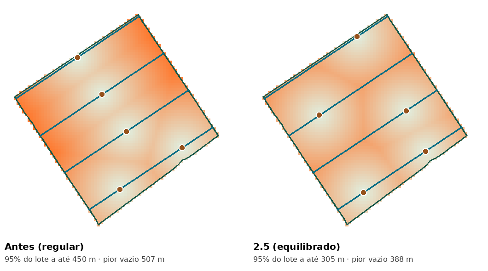

# 2.5.0 — motor equilibrado

## 1. O que mudou no motor

Antes, cada tiro recebia seus pontos em posições fixas: meia distância na borda e o resto a intervalos iguais.
Em lotes com tiros parecidos, os pontos formavam colunas ou uma diagonal, e partes do lote ficavam longe de
qualquer ponto.

Agora o plano padrão é **equilibrado**: os pontos de cada tiro podem deslizar juntos ao longo do tiro, e o motor
escolhe a posição que deixa o lote mais coberto. A troca segue quatro regras:

| Regra | Por quê |
|---|---|
| Mesmo total de pontos e **mesmos pontos por tiro** | A divisão da equipe não muda |
| Intervalo entre pontos do mesmo tiro igual | Quem caminha mantém o mesmo passo |
| **Pior vazio nunca maior** (checado a cada passo da busca e no fim) | Não abre buraco novo para ganhar na média |
| Só troca se o p95 cair **pelo menos 2%** | Ganho pequeno não justifica tirar os pontos da posição simétrica |

## 2. Resultado nos 51 lotes

| Medida | Valor |
|---|---:|
| Lotes que mudam | 31 de 51 |
| Ganho de cobertura (p95) nesses lotes | 11% na mediana, até 32% (RC7: 450 → 305 m) |
| Lotes com pior vazio maior | 0 |
| Lotes com equipe diferente | 0 |
| Escolha da recomendação | igual nos 51 |
| Tempo extra ao trocar de lote (celular lento) | cerca de 40 ms |

O botão "Buscar distribuição melhor" continua disponível. Ele ainda pode passar pontos de um tiro para outro.

## 3. Mapa

- **Rótulos "19,8 ha":** testam 4 posições em volta do ponto e ficam na primeira livre. Nos 51 lotes, 697 de 730
  aparecem e nenhum fica por cima de ponto, de outro rótulo ou cortado; os 33 restantes ficam escondidos.
- **Escala:** sempre curta (régua de 56 a 140 px). O crédito do satélite não invade a área da escala.
- **Botão de ferramentas:** ícone desenhado no lugar do caractere "☷", que alguns Android não mostram.
- **Subtítulo da marca:** o de 9 px sai no celular.

## 4. Testes

- `balanced-plan-browser.mjs`: 51 lotes no app. Plano em uso equilibrado; equipe, total, pior vazio e p95
  conferidos; ao menos 30 lotes com ganho.
- `engine-properties.test.mjs`: nova propriedade em lotes aleatórios (mesma equipe, p95 e pior vazio nunca piores,
  pontos dentro do lote).
- `engine-swap-browser.mjs`: o plano cru continua idêntico ao do motor 0.5.1; a recomendação faz a mesma escolha.
