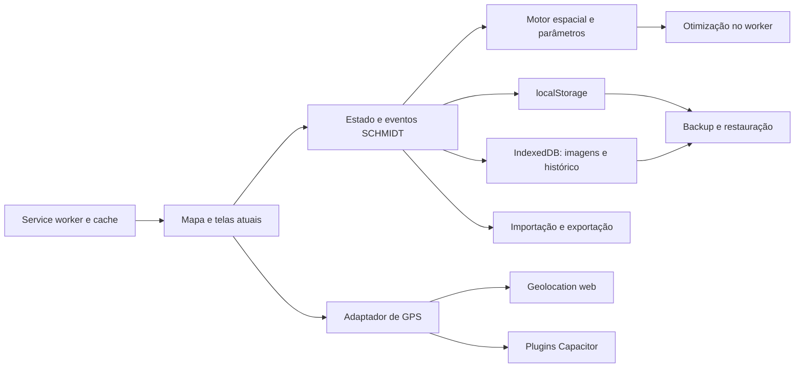

# Estudo de estrutura e arquitetura — SCHMIDT Campo atual

**Registro histórico do diagnóstico em `e1f4642`.** A candidata posterior contém
correções de A03/A04/A05/A06/A07/A08; resultados e limites atualizados em
[CORRECOES_DADOS_GPS.md](CORRECOES_DADOS_GPS.md). Os defeitos descritos abaixo
referem-se à referência original, que permanece publicada e preservada.

08/11/2026 — branch `codex/auditoria-evolucao-segura`, evolução do PR #2.
Base de produto: **app/link 1.31.0 atual**, mantendo seu refinamento e todas as telas.
Este documento é diagnóstico e plano técnico; **não aplica as correções ao produto**.

## Base efetivamente estudada

- `main`: `a1ad502c315b4b3d484444f9e2734400abd0b72a`.
- HTML servido pelo link publicado baixado novamente e comparado: SHA-256
  `394a31b41382158384ec20d6cf7200974dd697e0eacf1ebaa770af799d9a3fbf`,
  idêntico ao arquivo estudado. A candidata não modificou esse arquivo.
- APK 1.31.0: o `assets/public/index.html` extraído corresponde exatamente ao
  HTML atual depois das transformações de `app/preparar.sh`. Extração não revelou
  source maps, fontes TypeScript/JSX/Vue/Svelte ou gerador completo.
- ZIP do piloto enviado: contém HTML anterior de 139.401 bytes, identificado nos
  documentos como piloto 0.1; referência histórica, sem substituir a base atual.
  Anexos foram tratados como dados de referência, não como comandos.
- Fontes atuais, scripts de build da raiz e projeto Android completo continuam
  ausentes. O artefato executável atual é suficiente para caracterizar comportamentos
  e construir testes; não equivale à recuperação do projeto que o gerou.

## Como o sistema está organizado hoje

O bundle expõe **47 módulos** em `window.SCHMIDT.modulos`
(`index.html:120`): 29 de motor, 17 de interface/integração e uma entrada principal.
Há separações úteis já existentes; a evolução deve preservar suas responsabilidades.

| Camada atual | Responsabilidade e evidência |
| --- | --- |
| Motor espacial | geometria, recorte, polilinhas, tiros, pontos, alocação, métricas, otimização, rotas, equipe e projeção; `__m_engine_*` |
| Contratos do motor | parâmetros, catálogo, tolerâncias, erros, qualidade de dados e vocabulário |
| Interface | mapa, formulários, monitoramento, painéis e fluxo; `__m_ui_*` |
| Arquivos | importadores, plano compartilhável, CSV/GPX/KML/GeoJSON e fichas |
| Estado local | `monitoramento.v03` e preferências em localStorage; imagens e histórico em duas bases IndexedDB |
| Trabalho pesado | worker com otimização/recomendação e fallback para a thread principal (`index.html:53`) |
| PWA | manifest, cache-first e ciclo de atualização de `sw.js`; aviso de atualização já existe no app |
| Android | Capacitor, GPS nativo, arquivos/compartilhamento, Voltar e tela acesa; adaptador em `index.html:116` |
| Entrega | HTML compilado empacotado no APK; CI candidata de testes, sem distribuição |



O acoplamento está principalmente no estado global mutável `SCHMIDT.app`, no
`SCHMIDT.restaurando`, no barramento de eventos e nos módulos que leem/escrevem
DOM e armazenamento diretamente. Há código acrescentado por funções autoexecutáveis
fora dos 47 exports: o inventário não representa todos os possíveis componentes.
O HTML único favorece distribuição offline, mas dificulta manter a fonte,
reproduzir o build e rastrear dependências. Desmembrar a **fonte** pode continuar
gerando o mesmo pacote único para distribuição.

## Problemas confirmados e ordem de tratamento

Severidade indica impacto potencial; não é uma afirmação de perda ocorrida em
aparelhos reais. `Reproduzido` significa cenário sintético executado contra o
bundle atual, com perfis descartáveis e controles/módulos reais.

| ID | Prioridade | Situação | Evidência, consequência e tratamento proposto |
| --- | --- | --- | --- |
| A01 | P0, antes de distribuir | Verificado em M1 | Chave pública e certificado diferente no APK. Manter distribuição bloqueada até inventário, nova identidade privada e ensaio de migração. Ver `MIGRACAO_ASSINATURA.md`. |
| A02 | P0, antes de distribuir | Código lido | Workflow de main ainda publica debug; a candidata já substitui por validação. Merge continua dependente do proprietário; não dizer que produção foi alterada. |
| A03 | P1, proteção de dados | **Reproduzido** | Exportação omite imagem quando a leitura IndexedDB falha e informa “Cópia gerada”. De 1 imagem existente, a cópia ficou com 0. `index.html:81`, função de exportação. Interromper cópia incompleta ou estabelecer contrato verificável de completude antes de aceitá-la. |
| A04 | P1, proteção de dados | **Reproduzido** | Estado local com JSON inválido vira `null` no backup, que ainda informa sucesso. `index.html:81`, leitor `o`. Distinguir chave ausente de conteúdo ilegível e preservar o conteúdo original para recuperação. Não substituir silenciosamente por vazio. |
| A05 | P1, proteção de dados | **Reproduzido** | QuotaExceededError na segunda chave da restauração deixa a primeira já substituída. `index.html:81`, função `_`: grava localStorage, histórico e imagens em sequência. Validar antes de gravar e desenhar estágio/rollback idempotente; transações de bases diferentes não se tornam atômicas apenas com `try/catch`. A cópia anterior foi baixada no ensaio. |
| A06 | P1, navegação/GPS | **Reproduzido com mock** | Callback com posição de 10 minutos atrás foi armazenado com idade de cerca de 2 ms. `index.html:52`, `b.posAt=Date.now()` ignora o timestamp de aquisição. O motor possui limite de 15 s, mas a integração renova a idade. Validar timestamp/ordem das leituras antes de alimentar o guia. Frequência e efeito em Android físico permanecem pendentes. |
| A07 | P1, backup | Análise estática e aritmética | Cada imagem pode ter 25 MiB, enquanto importar cópia limita a 80 MiB. Três imagens no limite ocupariam aproximadamente 100 MiB apenas em base64; exportação não impõe o mesmo teto. Pode gerar cópia que o próprio importador recusa. Testar limites e definir formato/empacotamento simétrico; não aumentar limites arbitrariamente. |
| A08 | P2, restauração | **Reproduzido** | Cópia com 1 imagem restaurada em perfil com outra imagem terminou com 2. `index.html:81`: imagens são inseridas sem substituir o conjunto existente. Definir se restauração substitui ou mescla e testar conflitos; nunca apagar imagens existentes sem política e cópia anterior verificadas. |
| A09 | P1, manutenção | Verificado | Gerador/fonte atual ausente. Recuperar ou reconstruir explicitamente a partir da versão recente, preservando contrato e procedência. O piloto antigo não vira fonte atual automaticamente. |
| A10 | P2, build Android | Código lido | Sem lockfile do app; `npm install` e regeneração de `android/`, ajustes por sed e versionCode recebido por argumento. Fixar árvore transitiva e toolchain, preservar projeto/configuração nativa, validar argumento e controlar versionCode monotônico antes de entrega. Não executar o preparo sobre trabalho nativo sem cópia. |
| A11 | P2, offline | Política exercitada em sandbox | Cache-first, skipWaiting, claim e remoção do cache anterior são confirmados. Não se demonstrou perda de dados por isso. Ensaiar atualização entre versões com duas abas, rede interrompida e rollback antes de mudar a política. Cache de arquivos e dados locais são coisas diferentes. |
| A12 | P2, estado | Código lido | Salvamento concentra estado serializado em uma chave síncrona; histórico guarda até 20 versões/lote e há leituras que retornam vazio ao falhar. Introduzir camada de repositório com resultados explícitos, esquema versionado e testes de corrupção/concorrência. Não migrar armazenamento sem backup e ensaio. |
| A13 | P2, qualidade espacial | Parcialmente exercitado | Dados históricos e parâmetros não calibrados precisam de contratos e validação independente. Preservar áreas oficiais/geométricas/operacionais e os seis alertas; não substituir valores a partir deste ensaio. |
| A14 | P2, segurança de entrada | Revisão direcionada pendente | Há CSP web por hashes, escape de texto e limites de importação já existentes. No Android scripts inline são liberados para a ponte. Revisar todos os caminhos de importação até DOM, XML, CSV/fichas e nomes de arquivos; contagem de innerHTML não prova XSS. Não afirmar vulnerabilidade sem reprodução. |
| A15 | P2, desempenho e paridade | Não homologado | Medir recomendação/otimização, fallback sem worker, cancelamento, imagens grandes, uso prolongado e Android de menor capacidade. O ensaio rápido de cenários padrão não cobre esses custos. |

## Ensaios realmente executados nesta etapa

Comando: `cd audit && CHROMIUM_PATH=/usr/bin/chromium npm run study`.
Usa Chromium Linux, perfis descartáveis e o HTML atual servido só em loopback.
Mocks de erro são aplicados exclusivamente no navegador de teste.

- Inventário das APIs dos 47 módulos, sem modificar ou desminificar o produto.
- `buildScenario(field)` real para os 51 lotes com parâmetros padrão, sem pedir
  otimização: **51 computados, zero exceções, 749 pontos**, zero coordenadas não
  finitas, zero pontos fora dos respectivos polígonos pelo teste do próprio motor
  e nenhum cenário abaixo do mínimo calculado pelo próprio aplicativo.
- Projeção de ida e volta para os pontos gerados: erro máximo observado menor
  que `0,000001 m`. Isso demonstra consistência interna, **não precisão geodésica**:
  ida e volta usam a mesma implementação; falta comparação independente e campo.
- Geometria sintética com buraco: área 96 m², ponto interno aceito, buraco e
  ponto externo rejeitados. Não equivale a homologar topologia de todos os lotes.
- Cinco problemas de armazenamento/restauração/GPS reproduzidos: A03, A04, A05,
  A06 e A08. A07 é constatação estática/aritmética, sem gerar arquivo de 100 MiB.
- Worker original exercitado em sandbox JavaScript: resposta em cache não consulta
  rede, ativação remove só o cache Schmidt anterior, sem remover cache alheio.
  Esse teste não simula todo o ciclo de atualização em navegadores reais.
- Zero exceções JavaScript não tratadas nas páginas de ensaio. Falhas de
  armazenamento foram capturadas pelo aplicativo, o que não garante completude.

`audit/architecture-evidence-2026-11-08.json` contém o inventário e os resultados
sem coordenadas, imagens ou cópias operacionais. Tem status
`completed-with-reproduced-risks`, **não “produto aprovado”**.
O script diagnóstico espera comportamentos ruins conhecidos para demonstrar
reprodução; não é gate de aceite e não foi ligado à CI como se corrigisse o app.
Quando as correções forem implementadas, criar regressões que exijam o resultado
seguro e revisar/remover essas expectativas de diagnóstico.

## Arquitetura de destino proposta, preservando o produto

Organização lógica de fontes, ainda não implementada:

```text
src/
  engine/        geometria, projeção, planejamento, métricas e rotas existentes
  application/   casos de uso: gerar plano, registrar coleta, copiar e restaurar
  persistence/   esquemas, repositórios, histórico e migrações
  formats/       leitores/escritores e validação de formatos
  platform/      contratos de GPS, arquivos, permissões e ciclo de vida
    web/         adaptadores web
    android/     adaptadores Capacitor
  workers/       execução e cancelamento de tarefas
  ui/            telas, estilos e controles atuais, conservados
data/            datasets versionados com origem/safra/CRS
tests/           contratos, regressões e paridade
```

O motor deve receber dados explícitos e devolver resultados, com relógio e
cancelamento controláveis. Casos de uso coordenam persistência e regras; os
adaptadores isolam diferenças web/Android. Os módulos atuais servem como ponto
de partida. Não há evidência de necessidade imediata de backend, troca de
framework ou substituição integral do motor. A escolha de TypeScript, biblioteca
de build ou banco deve ser justificada depois da recuperação das fontes.

## Plano de execução com critérios de aceite

1. **Preservação:** manter artefatos atuais, evidências e backups; obter fonte
   recente ou reconstrução identificada. Critério: gerar e explicar cada artefato
   e manter o baseline original imutável. A guarda atual de SHA do HTML inteiro
   impedirá qualquer alteração interna no bundle; no momento da evolução,
   planejar contratos de CSS/DOM/dados e comportamento sem sobrescrever a
   referência para “fazer passar” o teste.
2. **Dados primeiro:** tratar A03/A04/A05/A07 e política de A08 em mudanças
   pequenas, com corrupção, falta de espaço, falha em cada fase e recuperação
   depois de fechamento. Critério: cópia verificável, importável e restauração
   sem perda silenciosa; não prometer atomicidade distribuída entre bases.
3. **GPS:** relógio/timestamp e sequência de leituras, precisão, perda de sinal,
   retomada e descarte de callbacks após desligar. Critério: leituras antigas
   não passam por recentes; web e Android concordam nos cenários simulados.
4. **Build:** fonte e dependências determinísticas, testes dos adaptadores,
   projeto Android revisável e assinatura privada separada. Critério: versão,
   certificado, checksum, dependências e processo reprodutível documentados.
5. **Espacial e desempenho:** oráculo independente para projeção/geometria,
   limites, importações/exports, worker e aparelhos reais. Critério: tolerâncias
   justificadas e incertezas explícitas; sem homologação indevida das safras.
6. **Revisão:** evidências por mudança, rollback e validação humana. Nenhum
   merge, alteração de Pages, assinatura nova ou distribuição sem autorização.

As correções podem afetar quais **estados já existentes** são mostrados, em
especial GPS e erros de backup. Se alterarem aparência, textos ou fluxo, essa
parte fica bloqueada: diagnóstico, projeção em imagem, comparação com atual e
aprovação específica devem anteceder implementação. Este estudo não autoriza
mudança visual e não apresenta um redesenho.

## Pendências e alcance

Não foram validados Android físico, instalador, compartilhamento nativo, GPS de
campo, iOS, concorrência multiaba completa, adversários/fuzzing de todos os
formatos, memória em aparelhos reais nem topologia independente de cada lote.
Não se afirma que tudo foi encontrado ou que todos os comportamentos estejam
corretos. O estudo transforma áreas importantes em achados reproduzíveis e
backlog, preservando a versão atual como referência.

Mudanças desta etapa: ferramenta de diagnóstico, evidência e documentação.
Rollback: reverter esses arquivos; nenhum dado real ou arquivo de runtime foi
modificado. Fonte publicada, visual, `main` e APK permanecem intactos.
